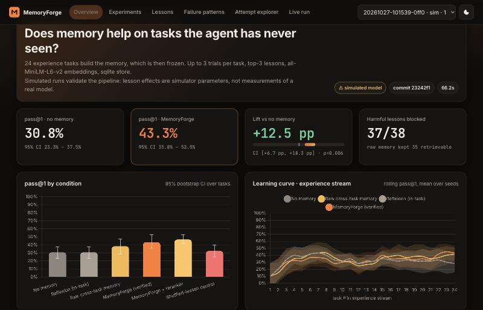
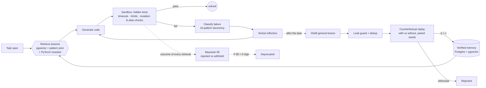
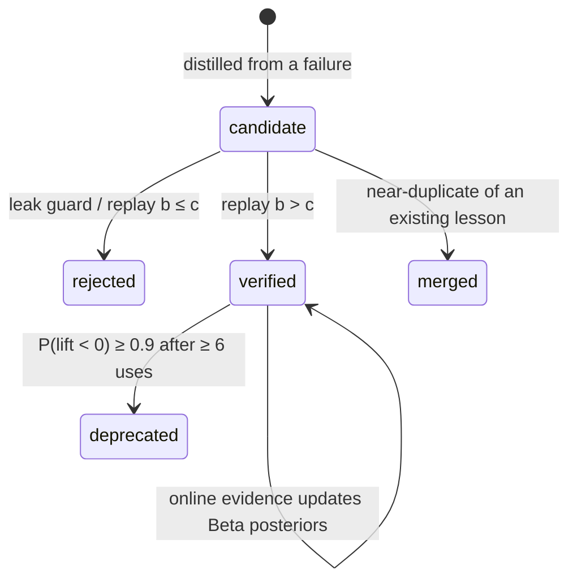
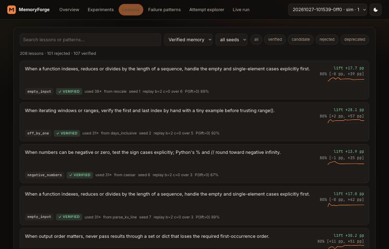

<div align="center">


# MemoryForge

**A coding agent that remembers why it failed, proves which lessons are true, and gets better on tasks it has never seen.**

[](https://github.com/coolstack-coder/MemoryForge/actions/workflows/ci.yml)


[Why](#why) · [How it works](#how-it-works) · [Results](#results) · [Quickstart](#quickstart) · [Dashboard](#dashboard) · [Real models](#running-against-a-real-model) · [Design notes](#design-notes-and-limitations)



</div>

MemoryForge records every attempt an autonomous coding agent makes, diagnoses **why** each failure happened, and distills those failures into short, general lessons. A lesson only becomes retrievable after it **survives counterfactual replay**. After that it keeps earning its place through a randomized hold-out arm and a Bayesian estimate of how much it helps. Lessons that stop helping are retired. Retrieval mixes semantic search over pgvector, a prior learned from past failures, and a **PyTorch reranker** trained on retrieval outcomes.

Then it asks the question that matters: **on unfamiliar tasks, with memory frozen, does any of this improve the agent?** The repository ships a 36-task benchmark, six experimental conditions including a shuffled-lesson control, paired statistics, and a dashboard that shows every number and every trial.

> [!NOTE]
> **Headline (simulated backend, 10 seeds × 12 held-out tasks):** verified memory lifts first-try pass rate from **30.8% → 43.3%** (+12.5 pp, 95% CI [+6.7, +18.3]). Solve rate within 3 trials goes from **65.8% → 91.7%**. Verification blocked **37 of 38** plausible-but-harmful lessons, while unverified memory kept all 35 of its own. When 60% of distilled lessons are bad, unverified memory drops *below* the no-memory baseline (22.2%) while verified memory holds at 38.9%. These numbers come from the offline simulator, which validates the pipeline. They are not a claim about any particular LLM; see [what the simulator can and cannot show](#what-the-simulator-can-and-cannot-show).

---

## Why

Coding agents repeat their mistakes. Every session starts blank, so the same off-by-one error, the same mutated argument and the same missing empty-input guard cost tokens again and again.

[Reflexion](https://arxiv.org/abs/2303.11366) showed that an agent which writes a verbal reflection after a failure and retries does better *within a task*. The reflections are thrown away when the task ends. Making them persistent sounds like the obvious next step. It creates three new problems:

1. **Bad lessons poison the well.** A reflection can sound right and still be wrong, misdiagnosed, or true only for one task. An agent that trusts all of its own notes can get *worse*.
2. **Similarity is not usefulness.** The nearest embedding is not necessarily the lesson that prevents the next bug.
3. **"It feels smarter" is not evidence.** A longer prompt can change behaviour on its own. A real claim needs held-out tasks, paired comparisons and a placebo.

MemoryForge treats every lesson as a **hypothesis**. It is admitted only if replaying the original failure with the lesson beats replaying it without the lesson. It keeps earning its place through a randomized control arm. And the whole system is judged on tasks the agent never trained on.

## How it works



### 1. Reflexion-style trial loop
For each task the agent gets up to `K = 3` trials. Every trial is stored with its code, test feedback, diagnosis, reflection, the lessons that were retrieved and the token count. ([`memoryforge/agent.py`](memoryforge/agent.py))

### 2. Sandboxed evaluation
Generated code runs in a fresh `python -I` subprocess. That process has CPU, file-size and (on Linux) memory rlimits, a stripped environment, per-test timeouts, and results passed through a random sentinel so `print` cannot spoof them. The tests file is deleted before the candidate is imported. The harness flags **mutated arguments** and **results that alias the input**. ([`memoryforge/sandbox/`](memoryforge/sandbox))

### 3. Failure-pattern classification
A rule-based classifier maps each failure onto a closed vocabulary of ten patterns. Its signals come from the exception, the shape of expected vs. actual output, and cheap AST checks; confidences are combined by noisy-or. On the simulator, where ground truth is known, it reaches **77.7% accuracy over 2,116 failures**. ([`memoryforge/failures/`](memoryforge/failures))

| pattern | what goes wrong |
|---|---|
| `empty_input` | empty list or string, single element, zero |
| `off_by_one` | inclusive vs. exclusive ends, loop bounds, slice ends |
| `tie_ordering` | equal keys come out in the wrong (unstable) order |
| `whitespace_case` | parsing breaks on extra whitespace, tabs, case, unicode |
| `negative_numbers` | sign handling, `%` and `//` on negatives, truthiness of 0 |
| `mutates_input` | the caller's argument is modified |
| `shared_reference` | the result aliases mutable input objects |
| `float_rounding` | float formatting or rounding mode gives a slightly wrong number |
| `inefficient` | correct but quadratic; times out on large inputs |
| `error_contract` | wrong exception, or none where the spec demands one |

### 4. Distillation, leak guard, de-duplication
After a task, each diagnosed failure is distilled into one imperative rule of the form *"When …, …"*. A lesson is rejected if it names the task, quotes a test literal, or is too long to be general. Near-duplicates (cosine ≥ 0.9, same pattern) are merged, and the lesson's context embedding widens to cover both source tasks. ([`memoryforge/memory/lessons.py`](memoryforge/memory/lessons.py))

### 5. Verification: the twist
**Counterfactual replay.** The agent re-attempts the source task with and without the lesson using paired seeds, starting with the seed that originally failed. A seed counts as *improved* (b) when the lesson turns a failure into a pass or removes its own failure pattern, and as *worsened* (c) in the mirror case. The lesson is verified iff `b ≥ 1` and `b > c`. Replay stops early once the evidence is decisive.

**Online attribution.** Every time a verified lesson is retrieved during the experience phase, it is **withheld from the prompt with 15% probability**, a randomized control. Two Beta posteriors track whether the lesson's own failure pattern was avoided:

```
p1 ~ Beta(α, β)     lesson injected
p0 ~ Beta(α0, β0)   lesson withheld   (pooled over lessons with the same pattern)
lift = p1 − p0      → Monte-Carlo mean, 80% interval, P(lift > 0)
```

A verified lesson with at least 6 injections and `P(lift < 0) ≥ 0.9` is **deprecated** and never retrieved again.



### 6. Retrieval
```
score = 0.35·sim + 0.25·prior + 0.20·pattern_match + 0.12·utility + 0.08·recency
```
* **sim**: max(cos(task, lesson text), cos(task, lesson's source task)) from pgvector
* **prior**: a kernel-weighted vote over *all* past failures: how often tasks like this one failed with the lesson's pattern
* **pattern_match**: the lesson targets the pattern just diagnosed on this task (retry trials only)
* **utility**: 0.5 + posterior mean lift; **recency**: exp(−tasks since written / 40)

At most one lesson per pattern is injected, so the prompt is not padded with redundant advice. After the experience phase a **PyTorch MLP reranker** (9 features → 32 → 16 → 1) is trained on the logged retrieval events. It is blended with the formula in proportion to how far its held-out AUC beats the formula's. ([`memoryforge/memory/retrieval.py`](memoryforge/memory/retrieval.py), [`reranker.py`](memoryforge/memory/reranker.py))

## The benchmark

36 **original** tasks (not HumanEval, MBPP or LeetCode copies) with hidden tests, split into a 24-task **experience stream** and **12 held-out evaluation tasks**. Tasks share pitfalls but not answers: every pattern in the eval set occurs in training, and no eval task appears there. Examples: `merge_inclusive_spans`, `rank_with_ties`, `split_cents`, `free_ranges`, `apportion`, `shortest_cover_span`, `max_drawdown`.

Every task ships a reference solution and 2–3 **hand-written buggy variants**, each tagged with the pattern it exhibits. `memoryforge validate` checks that every reference passes and every bug fails for the right reason. The variants power the offline simulator and give the classifier ground truth. ([`memoryforge/bench/`](memoryforge/bench))

### Conditions

| key | label | in-task reflection | cross-task memory | retrieval |
|---|---|:-:|:-:|---|
| `none` | No memory | | | retries see raw test feedback |
| `reflexion` | Reflexion (in-task) | ✓ | | — |
| `raw_memory` | Raw cross-task memory | ✓ | every distilled reflection | hybrid |
| `verified` | **MemoryForge** | ✓ | verified lessons only | hybrid |
| `verified_rerank` | MemoryForge + reranker | ✓ | same memory as `verified` | hybrid + PyTorch reranker |
| `shuffled` | Shuffled-lesson control | ✓ | same memory as `verified` | **random**, same count |

**Protocol (per seed):** run the experience stream in a seed-specific order, writing memory as you go. Then **freeze memory** and evaluate every condition on the 12 held-out tasks. `verified_rerank` and `shuffled` reuse exactly the memory that `verified` built, so they differ only in retrieval.

**Statistics:** task-level outcomes are averaged over seeds. The **paired bootstrap** (5,000 resamples over tasks) gives 95% CIs on differences. **Exact McNemar** on (seed, task) pairs gives p-values, with Holm correction across contrasts. Effect sizes come first. ([`memoryforge/eval/stats.py`](memoryforge/eval/stats.py))

## Results

> [!IMPORTANT]
> Everything in this section was produced by the **simulated** backend. It is reproducible bit-for-bit with `memoryforge bench --seeds 10` (raw output in [`docs/results/sim-10seeds.json`](docs/results/sim-10seeds.json)). It shows that the machinery measures what it should. It is **not** evidence about a specific model.

**Held-out evaluation, 10 seeds × 12 unseen tasks, K = 3, top-3 lessons, MiniLM embeddings.**

| Condition | pass@1 | 95% CI | solved@3 | mean trials* | tokens / solved |
|---|---:|---|---:|---:|---:|
| No memory | 30.8% | [23.3, 37.5] | 65.8% | 2.51 | 584 |
| Reflexion (in-task) | 30.8% | [23.3, 37.5] | 76.7% | 2.37 | 945 |
| Raw cross-task memory | 38.3% | [28.3, 47.5] | 85.8% | 2.04 | 876 |
| **MemoryForge (verified)** | **43.3%** | [35.8, 52.5] | **91.7%** | **1.92** | 763 |
| MemoryForge + reranker | **46.7%** | [41.7, 52.5] | 85.0% | 2.00 | 850 |
| Shuffled-lesson control | 32.5% | [25.0, 40.0] | 81.7% | 2.28 | 1064 |

<sub>*unsolved tasks counted as K+1</sub>

**Paired contrasts on pass@1** (difference, 95% bootstrap CI, McNemar b/c, Holm-adjusted p):

| A vs B | Δ pass@1 | 95% CI | b / c | p (Holm) |
|---|---:|---|---:|---:|
| verified vs none | **+12.5 pp** | [+6.7, +18.3] | 21 / 6 | 0.059 |
| verified vs shuffled control | **+10.8 pp** | [+2.5, +18.3] | 22 / 9 | 0.18 |
| raw memory vs none | +7.5 pp | [0.0, +15.0] | 17 / 8 | 0.43 |
| verified vs raw memory | +5.0 pp | [−6.7, +15.0] | 14 / 8 | 0.86 |
| reranker vs verified | +3.3 pp | [−1.7, +8.3] | 6 / 2 | 0.86 |

On **solved@3**, verified beats no memory by **+25.8 pp** [+17.5, +34.2] (b/c = 32/1, p_Holm < 0.001) and beats raw memory by +5.8 pp [+0.8, +10.8].

**What the memory looked like:**

| | lessons / seed | verified | rejected | harmful lessons written | harmful still retrievable | eval retrievals that were harmful |
|---|---:|---:|---:|---:|---:|---:|
| raw memory | 16.8 | — | — | 35 | **35** | 97 / 684 |
| verified | 20.8 | 107 | 101 | 38 | **1** | 10 / 660 |

### Reading the results honestly
* **Memory helps, and it is not just a longer prompt.** The shuffled control has the same memory, the same number of lessons, and *more* tokens per solved task, yet it is no better than no memory on pass@1. The gain comes from retrieving the *right* lessons.
* **Verification is a precision filter.** It throws away about half of all candidates, including nearly every plausible-but-wrong rule, and still ends up with the best solve rate. On pass@1 its edge over raw memory is positive but its CI includes zero at this harm rate. The sweep below shows how the gap grows as bad lessons become more common.
* **The reranker's gain is mixed.** It improves pass@1 by +3.3 pp but lowers solved@3. With roughly 400 events per seed its held-out AUC beats the formula in 7 of 10 seeds. That is a data-volume problem worth stating plainly rather than hiding.
* **In-task reflection alone does not change pass@1**, by construction: the first trial has nothing to reflect on. It does lift solved@3 by +10.8 pp, as in the Reflexion paper.

### Sensitivity: how much does verification matter when lessons can be wrong?

`memoryforge sweep` varies the simulator's rate of plausible-but-harmful distilled lessons (6 seeds each):

| harmful-lesson rate | no memory | raw memory | **verified** | verified − raw (pass@1) | verified − raw (solved@3) | harmful lessons retrieved by raw memory |
|---:|---:|---:|---:|---|---|---:|
| 0.0 | 29.2% | 41.7% | **47.2%** | +5.6 pp [0.0, +11.1] | +2.8 pp [−2.8, +6.9] | 0 |
| 0.2 | 29.2% | 34.7% | **36.1%** | +1.4 pp [−8.3, +11.1] | +9.7 pp [0.0, +18.1] | 71 |
| 0.4 | 29.2% | 30.6% | **40.3%** | +9.7 pp [−8.3, +27.8] | **+19.4 pp** [+6.9, +33.3] | 164 |
| 0.6 | 29.2% | **22.2%** | **38.9%** | **+16.7 pp** [+6.9, +26.4] | **+31.9 pp** [+22.2, +43.1] | 243 |

Unverified memory degrades as bad lessons become common, and at a 60% harm rate it is **worse than having no memory at all**. Verified memory stays between 36% and 47% pass@1 throughout. That is the core argument for verifying lessons rather than storing reflections: you rarely know in advance how often your agent's self-diagnosis is wrong. (pass@1 columns; 6 seeds each, 95% bootstrap CIs on the paired differences.)

### What the simulator can and cannot show
The simulated backend is a deterministic "developer" ([`memoryforge/llm/simulated.py`](memoryforge/llm/simulated.py)). For each pitfall of a task it writes the corresponding hand-made bug with probability `p`. A relevant lesson multiplies `p` by `1 − 0.8`, a reflection naming the pattern by `1 − 0.6`, and every irrelevant lesson adds `0.03`. Reflections misdiagnose 30% of the time, and 20% of distilled lessons are harmful rules that *raise* `p` by 0.35. It reads only the `pattern=` tags and the known harmful templates, never the lesson's wording.

So a simulated run **can** show that the sandbox, classifier, distillation, leak guard, verification, retrieval, reranker, statistics and dashboard work end to end and measure the effects they should. It **cannot** show that memory helps a real model; the effect size is an input. Every simulated result is labelled as such in the CLI, the JSON and the dashboard. For real evidence, run the same command against a model ([below](#running-against-a-real-model)).

## Quickstart

**Local (SQLite, no services):**
```bash
git clone https://github.com/coolstack-coder/MemoryForge.git && cd MemoryForge
make install            # venv + editable install with postgres, embeddings and dev extras
make bench              # 10 seeds, all six conditions (about a minute on a laptop)
make serve              # dashboard on http://127.0.0.1:8765
```

**Docker (Postgres + pgvector):**
```bash
docker compose run --rm --build bench    # benchmark, memory stored in pgvector
docker compose up --build app            # dashboard on http://localhost:8765
```

**Tests:**
```bash
make test               # 30 tests: sandbox, simulator, classifier, memory, stats, end-to-end API
```

## Dashboard

`memoryforge serve` starts a FastAPI app with a single-page dashboard. It has dark and light themes and works down to phone width.

| | |
|---|---|
| **Overview** | headline pass@1 with and without memory, lift with its CI, harmful lessons blocked, per-condition bars with error bars, learning curve over the experience stream |
| **Experiments** | every condition, a forest plot of paired contrasts, memory composition, reranker AUC per seed |
| **Lessons** | searchable lesson browser: status, pattern, uses, replay counts, posterior lift with an 80% interval and a sparkline of lift over time |
| **Failure patterns** | pass@1 per pitfall per condition, and the classifier's confusion matrix |
| **Attempt explorer** | pick a task, condition and seed to see each trial's retrieved lessons and scores, test feedback, reflection, and the code diff between trials |
| **Live run** | start a simulated benchmark from the browser and watch it stream |



## Running against a real model

Any server that speaks the OpenAI-compatible `/v1/chat/completions` format works: Ollama, vLLM, LM Studio, llama.cpp server or a hosted gateway. For example, with Ollama:

```bash
ollama pull qwen2.5-coder:7b
export MF_LLM_BACKEND=openai_compatible MF_LLM_BASE_URL=http://localhost:11434/v1 MF_LLM_MODEL=qwen2.5-coder:7b
memoryforge solve rank_with_ties --learn          # watch one task: trials, reflections, lessons
memoryforge bench --backend openai_compatible --seeds 3
```

Or fully local on PyTorch with Hugging Face transformers (`pip install -e ".[local]"`):

```bash
MF_HF_MODEL=Qwen/Qwen2.5-Coder-1.5B-Instruct memoryforge bench --backend hf_local --seeds 3
```

With a real model, the same code paths produce the same tables. The difference is that the effect sizes are now measurements. Budget for it: one seed with all six conditions is roughly 4 × 24 + 6 × 12 tasks, up to 3 trials each, plus reflections, distillation and replay.

## CLI

```text
memoryforge bench     [--seeds N] [--conditions a,b,c] [--backend simulated|openai_compatible|hf_local]
                      [--trials K] [--top-k K] [--embedder auto|minilm|hash] [--sim '{"harmful_rate":0.4}']
memoryforge solve     <task_id> [--condition verified] [--learn]
memoryforge sweep     [--rates 0,0.2,0.4,0.6] [--seeds N]
memoryforge validate
memoryforge serve     [--host 127.0.0.1] [--port 8765]
```

## Configuration

| variable | default | meaning |
|---|---|---|
| `MF_DATABASE_URL` | *(empty)* | Postgres DSN; empty means SQLite |
| `MF_SQLITE_PATH` | `runs/memoryforge.sqlite3` | SQLite file when no Postgres |
| `MF_LLM_BACKEND` | `simulated` | `simulated`, `openai_compatible`, `hf_local` |
| `MF_LLM_BASE_URL` | `http://localhost:11434/v1` | OpenAI-compatible endpoint |
| `MF_LLM_MODEL` | `qwen2.5-coder:7b` | model name for that endpoint |
| `MF_LLM_API_KEY` | *(empty)* | bearer token if the endpoint needs one |
| `MF_HF_MODEL` | `Qwen/Qwen2.5-Coder-1.5B-Instruct` | model for `hf_local` |
| `MF_EMBEDDER` | `auto` | `minilm` (sentence-transformers), `hash` (offline), `auto` |
| `MF_OFFLINE` | — | `1` forces hashed embeddings (used in CI) |
| `MF_MAX_TRIALS` / `MF_TOP_K` | `3` / `3` | trials per task / lessons per prompt |
| `MF_SANDBOX_TIMEOUT` | `6` | wall-clock seconds per sandbox run |

## Project layout

```text
memoryforge/
├── agent.py              # trial loop, distillation, counterfactual replay
├── conditions.py         # the six experimental conditions
├── failures_vocab.py     # shared 10-pattern vocabulary
├── bench/                # 36 tasks (reference + buggy variants + hidden tests), validator
├── sandbox/              # subprocess runner, in-sandbox harness, code extraction
├── failures/             # rule-based failure classifier
├── llm/                  # backends: simulated, openai_compatible, hf_local; prompts
├── memory/
│   ├── store.py          # SQLite + numpy  |  Postgres + pgvector, one interface
│   ├── schema.sql        # pgvector schema with HNSW indexes
│   ├── embeddings.py     # MiniLM (PyTorch) with hashed n-gram fallback
│   ├── lessons.py        # leak guard, dedup, deprecation
│   ├── utility.py        # Beta posteriors and lift
│   ├── retrieval.py      # hybrid scoring and experience prior
│   └── reranker.py       # PyTorch MLP reranker
├── eval/                 # experiment runner and paired statistics
└── server/               # FastAPI app + static dashboard
tests/                    # 30 tests
docs/                     # screenshots and checked-in results
```

## Design notes and limitations

* **The sandbox is not a security boundary.** It relies on a subprocess, rlimits and an AST tripwire. Run untrusted models inside the provided container, which drops capabilities and limits pids and memory.
* **The classifier is rule-based.** It is strong on exceptions, timeouts, mutation and aliasing (≈95–100%) and weak on `whitespace_case` and `float_rounding` (≈17–25%), where the symptom looks like a generic wrong answer. Misdiagnoses flow into lessons, which is one reason verification exists.
* **Replay costs calls.** Verification spends up to 2 × 10 generations per new lesson (fewer with early stopping). With real models that is the main cost of the method, so it is worth measuring against the gain.
* **The online hold-out costs a little performance on purpose.** 15% of retrievals during the experience phase are withheld to keep lift estimates causal.
* **Small benchmark.** 12 held-out tasks × 10 seeds is enough to see a 12 pp effect, not a 3 pp one. The task format is simple, so adding tasks is cheap.
* **Postgres and SQLite share one interface and one scoring function.** The pgvector query narrows candidates by nearest neighbour, then the same Python code scores them, so rankings match across stores.

## Roadmap

- [ ] Real-model results (Qwen2.5-Coder 7B via Ollama, plus a hosted model) with cost per solved task
- [ ] LLM fallback for low-confidence failure classification
- [ ] Held-out probe tasks per pattern as a third verification signal
- [ ] Larger task suite with repository-level tasks
- [ ] Lesson editing and merging by the agent (ADD / EDIT / MERGE operations)

## Citation

MemoryForge builds on Reflexion:

```bibtex
@inproceedings{shinn2023reflexion,
  title     = {Reflexion: Language Agents with Verbal Reinforcement Learning},
  author    = {Shinn, Noah and Cassano, Federico and Berman, Edward and Gopinath, Ashwin and Narasimhan, Karthik and Yao, Shunyu},
  booktitle = {Advances in Neural Information Processing Systems},
  year      = {2023}
}

@software{advani2026memoryforge,
  title  = {MemoryForge: persistent, verified experience memory for coding agents},
  author = {Advani, Anmol},
  year   = {2026},
  url    = {https://github.com/coolstack-coder/MemoryForge}
}
```

## License

[MIT](LICENSE) © 2026 Anmol Advani
